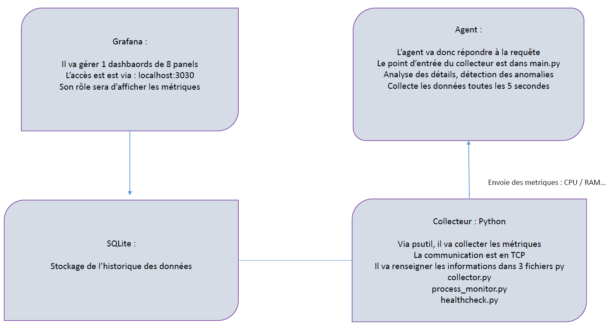

# SysWatch-API

## 1. Présentation du projet

SysWatch-API est donc une solution de supervision système développée en Python permettant de collecter, analyser, stocker et visualiser les métriques d'un ordinateur en temps réel.

Les données sont enregistrées dans une base SQLite et visualisées à travers un tableau de bord Grafana.

## 2. Fonctionnalités

- Supervision du processeur (CPU).
- Surveillance de la mémoire vive (RAM).
- Surveillance de l'espace disque.
- Mesure des opérations de lecture et d'écriture (IOPS).
- Surveillance de l'expiration des certificats SSL.
- Détection automatique des dépassements de seuils.
- Calcul du taux de disponibilité des services (SLA).
- Journalisation des événements et incidents.

## 3. Composants que j'ai utilisé 

- Python
- Psutil
- SQLite
- Grafana
- JSON
- Git

## 4. Architecture de structure

    SysWatch-API/
    ├── src/
    │   ├── main.py
    │   ├── collector.py
    │   ├── process_monitor.py
    │   ├── database.py
    │   ├── healthcheck.py
    │   ├── alerts.py
    │   ├── config.py
    │   └── logger.py
    ├── data/
    ├── grafana/
    ├── docs/
    ├── tests/
    ├── logs/
    ├── config.json
    ├── requirements.txt
    └── README.md

## 5. Architecture d'infrastructure

## 6. Dashboard Grafana

Installer Grafana ainsi que le plugin SQLite Data Source (frser-sqlite-datasource).

Le dashboard contient huit panels :

1. Utilisation CPU
2. Utilisation RAM
3. Utilisation disque
4. Activité disque (IOPS)
5. Supervision des processus
6. Disponibilité des services
7. SLA
8. Journal des incidents

### Aperçu du dashboard

## 7. Tests de fonctionnalités

Les tests automatisés ont été réalisés avec Pytest.

- Collecteur : 3 tests réussis.
- Alertes : 7 tests réussis.
- Base SQLite : 5 tests réussis.

Résultat : 15 tests réussis sur 15.

## 8. Conclusion

SysWatch-API permet de centraliser la supervision des ressources système, de surveiller la disponibilité des services et de détecter automatiquement les anomalies grâce à une architecture modulaire.
